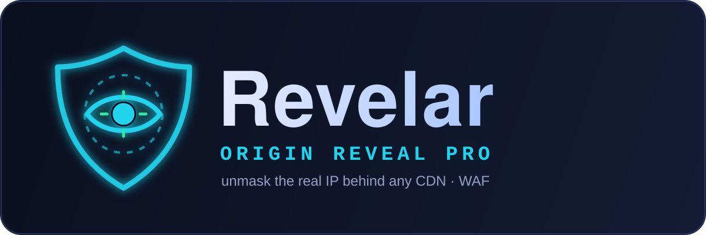

<p align="center">
  
</p>

<p align="center">
  <b>Unmask the real/origin IP behind any CDN &middot; WAF</b><br>
  <a href="https://golang.org/"></a>
  
  
  <a href="https://t.me/RootAccessClub"></a>
</p>

# Revelar — Origin Reveal PRO (v2)

**Revelar** is a fast, modular Go CLI for discovering the **real/origin IP** of websites hidden behind CDNs and WAFs (Cloudflare, Akamai, Fastly, CloudFront, Imperva, Sucuri, ArvanCloud, DDoS-Guard, Gcore, and more).

It combines **passive reconnaissance**, **heuristic candidate filtering**, and **active origin confirmation** (including a deep range-scanning mode) into clean JSON + HTML reports.

> ⚖️ **Authorized security testing only.** Do not scan systems without explicit permission.

---

## ✨ What's new in v2

- **Modular architecture** — small, tested Go packages instead of one 1,400-line file.
- **Live CDN ranges** — Cloudflare / Fastly / CloudFront ranges pulled from their official feeds (cached 24h) and merged with a built-in list covering 15+ providers.
- **18 passive sources** — crt.sh, CertSpotter, HackerTarget, AlienVault OTX, urlscan.io, Anubis, Wayback, RapidDNS, plus keyed SecurityTrails, Shodan, Censys, VirusTotal, ViewDNS, Netlas, FOFA, ZoomEye, BinaryEdge and Quake (keyed sources auto-enable when their env var is set).
- **Smarter detection** — CDN identified via IP ranges, reverse DNS, CNAME chains **and** HTTP response headers.
- **Real active verification** — builds a baseline fingerprint of the true site (status, title, body SHA-256, **SimHash** content similarity, TLS cert SANs) and scores every candidate 0–100.
- **TLS-certificate pivoting** — connects to each candidate IP and checks whether the presented certificate actually covers the domain, a strong origin signal that works even when the server alters or blocks HTTP.
- **Alternate origin ports** — probes common Cloudflare-compatible origin ports (8080, 8443, 2053, 2083, …), not just 80/443.
- **Deep active mode** — with `-active -deep`, Revelar probes every IP in the target's SPF-advertised ranges (and optionally whole candidate ASNs via RIPEstat) with the correct Host header to brute-force the origin **even when the site is otherwise fully proxied**.
- **Favicon pivot** — computes the Shodan-compatible `mmh3` favicon hash to find origins serving the same icon.
- **ASN enrichment** — every candidate annotated with ASN/org via Team Cymru (no key needed).
- **Native concurrent subdomain brute-force** with wildcard detection — no external tools required.
- **SPF / MX / NS parsing** to surface non-CDN infrastructure.
- **Modern dark HTML report**, JSON output, and a combined `_summary.csv`.
- **Unit tests + CI + cross-platform release workflow.**

---

## 📥 Install

```
go install github.com/MRvirusIR/Revelar@latest
```

Or build from source:

```
git clone https://github.com/MRvirusIR/Revelar.git
cd Revelar
go build -o Revelar .
./Revelar -d example.com
```

External tools and wordlists are **optional** — see `requirements.sh`.

---

## 💻 Usage

```
# Passive discovery
Revelar -d example.com

# Passive + active origin confirmation
Revelar -d example.com -active

# Add native brute force and external tools
Revelar -d example.com -active -brute -tools

# Deep mode: brute-force the origin across SPF + ASN ranges
Revelar -d example.com -active -deep -deep-asn

# Scan many domains, free sources only
Revelar -f domains.txt -sources free

# Custom resolvers and wordlist
Revelar -d example.com -brute -w wordlist.txt -resolver 1.1.1.1 -resolver 8.8.8.8
```

### Key flags

| Flag | Description |
| --- | --- |
| `-d` / `-f` | single domain / file of domains |
| `-o` | output directory (default `results`) |
| `-sources` | `all` \| `free` \| `none` \| comma list |
| `-active` | probe candidate IPs and score against the real site |
| `-min-score` | score to mark a candidate verified (default 65) |
| `-deep` / `-deep-asn` | probe SPF / ASN provider ranges to brute-force the origin |
| `-deep-max` | max IPs to probe in deep mode (default 4096) |
| `-brute` / `-w` | native subdomain brute force / wordlist |
| `-tools` | also run `subfinder` / `amass` if installed |
| `-resolver` | custom DNS resolver (repeatable) |
| `-threads` | concurrency (default 40) |
| `-json` / `-quiet` / `-no-color` | output controls |

Run `Revelar -h` for the full list.

---

## 🔑 Optional API keys

Set any of these in your environment and the matching source turns on automatically:

```
SHODAN_API_KEY, CENSYS_API_ID, CENSYS_API_SECRET, SECURITYTRAILS_API_KEY,
VT_API_KEY, VIEWDNS_API_KEY, URLSCAN_API_KEY, CERTSPOTTER_API_KEY, OTX_API_KEY,
NETLAS_API_KEY, FOFA_EMAIL, FOFA_KEY, ZOOMEYE_API_KEY, BINARYEDGE_API_KEY, QUAKE_API_KEY
```

---

## 🧠 How it finds the origin

1. **Front-door profiling** — resolves the apex, detects the CDN/WAF from IP ranges, PTR, CNAME and HTTP headers.
2. **Passive expansion** — pulls subdomains and historical/related IPs from 18 sources, certificate transparency, passive DNS, the favicon hash and SPF records.
3. **Candidate filtering** — resolves everything, drops CDN-owned IPs, keeps only public non-CDN addresses, and enriches each with ASN/org.
4. **Active verification** — fingerprints the real site, then connects to each candidate forcing the real `Host`/SNI and scores the response (identical body, content SimHash, TLS cert, title, status, server).
5. **Deep scan (optional)** — if nothing confirms, it sweeps the SPF and candidate-ASN ranges the same way to surface a hidden origin.

---

## 📂 Output

```
results/
  example.com/
    results.json    # full structured result
    results.html    # modern dark report
  _summary.csv      # one row per domain scanned
```

---

## 🧱 Architecture

```
main.go / cli.go        CLI, flags, console summary
internal/scanner        pipeline orchestration + deep scan
internal/cdn            CDN detection + live ranges
internal/dnsr           DNS, SPF parsing, brute force
internal/sources        18 passive recon sources
internal/favicon        Shodan-compatible mmh3 hash
internal/asn            ASN/org + announced prefixes
internal/verify         active fingerprint + scoring
internal/report         JSON / HTML / CSV
internal/tools          optional subfinder / amass
internal/util           shared helpers
```

Run the tests:

```
go test ./...
```

---

## ⚖️ Legal

This tool is for **authorized** security testing only. The authors assume no liability for misuse.

## 🔗 Links

Telegram: [BugCod3](https://t.me/BugCod3) · [RootAccessClub](https://t.me/RootAccessClub) — License: MIT
