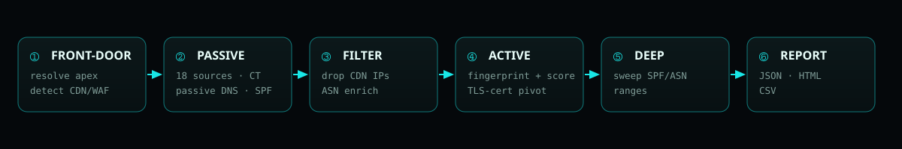

<div align="center">

<a href="https://github.com/MRvirusIR/Revelar">
  
</a>

<br>

[](https://github.com/MRvirusIR/Revelar/releases/latest)
[](https://golang.org/)
[](https://github.com/MRvirusIR/Revelar/releases/latest)
[](LICENSE)
[](https://t.me/BugCod3)

**[Install](#-install)** ·
**[Usage](#-usage)** ·
**[How it works](#-how-it-finds-the-origin)** ·
**[Pipeline](#-the-pipeline)** ·
**[Output](#-output)** ·
**[Telegram](#-community)**

</div>

<br>

> [!NOTE]
> **A CDN hides the server, not the site.** One leaked DNS record, one old certificate, one misconfigured SPF range — and the real box is exposed. **Revelar** pulls every such breadcrumb from 18+ sources, drops everything the CDN owns, then *actually connects* to each candidate and proves which one is the origin — scored `0–100`, as clean JSON + HTML.

<table>
<tr>
<td width="25%" align="center"><b>🛰️ 18+ sources</b><br><sub>CT logs, passive DNS,<br>favicon &amp; SPF pivots.</sub></td>
<td width="25%" align="center"><b>🎯 Proven, not guessed</b><br><sub>TLS-cert + content<br>fingerprint, scored 0–100.</sub></td>
<td width="25%" align="center"><b>🧱 Modular Go</b><br><sub>Small tested packages,<br>one static binary.</sub></td>
<td width="25%" align="center"><b>🕳️ Deep mode</b><br><sub>Sweeps SPF / ASN ranges<br>when the site is fully proxied.</sub></td>
</tr>
</table>

---

## 🎬 It in action

<div align="center">

</div>

---

## ✨ What's new in v2

- **Modular architecture** — small, tested Go packages instead of one 1,400-line file.
- **Live CDN ranges** — Cloudflare / Fastly / CloudFront ranges pulled from their official feeds (cached 24h) and merged with a built-in list covering 15+ providers.
- **18 passive sources** — crt.sh, CertSpotter, HackerTarget, AlienVault OTX, urlscan.io, Anubis, Wayback, RapidDNS, plus keyed SecurityTrails, Shodan, Censys, VirusTotal, ViewDNS, Netlas, FOFA, ZoomEye, BinaryEdge and Quake (keyed sources auto-enable when their env var is set).
- **Smarter detection** — CDN identified via IP ranges, reverse DNS, CNAME chains **and** HTTP response headers.
- **Real active verification** — builds a baseline fingerprint of the true site (status, title, body SHA-256, **SimHash** content similarity, TLS cert SANs) and scores every candidate 0–100.
- **TLS-certificate pivoting** — connects to each candidate IP and checks whether the presented certificate actually covers the domain — a strong origin signal even when the server alters or blocks HTTP.
- **Alternate origin ports** — probes common Cloudflare-compatible origin ports (8080, 8443, 2053, 2083, …), not just 80/443.
- **Deep active mode** — with `-active -deep`, Revelar probes every IP in the target's SPF-advertised ranges (and optionally whole candidate ASNs via RIPEstat) with the correct Host header to brute-force the origin **even when the site is otherwise fully proxied**.
- **Favicon pivot** — computes the Shodan-compatible `mmh3` favicon hash to find origins serving the same icon.
- **ASN enrichment** — every candidate annotated with ASN/org via Team Cymru (no key needed).
- **Native concurrent subdomain brute-force** with wildcard detection — no external tools required.
- **Modern dark HTML report**, JSON output, and a combined `_summary.csv`.
- **Unit tests + CI + cross-platform release workflow.**

---

## 📥 Install

**Download a prebuilt binary** for Linux / macOS / Windows from the [latest release](https://github.com/MRvirusIR/Revelar/releases/latest).

**With Go:**

```bash
go install github.com/MRvirusIR/Revelar@latest
```

**From source:**

```bash
git clone https://github.com/MRvirusIR/Revelar.git && cd Revelar
go build -o revelar .
./revelar -d example.com
```

External tools and wordlists are **optional** — see `requirements.sh`.

---

## 💻 Usage

```bash
# Passive discovery
revelar -d example.com

# Passive + active origin confirmation
revelar -d example.com -active

# Add native brute force and external tools
revelar -d example.com -active -brute -tools

# Deep mode: brute-force the origin across SPF + ASN ranges
revelar -d example.com -active -deep -deep-asn

# Scan many domains, free sources only
revelar -f domains.txt -sources free

# Custom resolvers and wordlist
revelar -d example.com -brute -w wordlist.txt -resolver 1.1.1.1 -resolver 8.8.8.8
```

### Key flags

| Flag | Description |
| --- | --- |
| `-d` / `-f` | single domain / file of domains |
| `-o` | output directory (default `results`) |
| `-sources` | `all` \| `free` \| `none` \| comma list |
| `-active` | probe candidate IPs and score against the real site |
| `-min-score` | score to mark a candidate verified (default 65) |
| `-deep` / `-deep-asn` | probe SPF / ASN provider ranges to brute-force the origin |
| `-deep-max` | max IPs to probe in deep mode (default 4096) |
| `-brute` / `-w` | native subdomain brute force / wordlist |
| `-tools` | also run `subfinder` / `amass` if installed |
| `-resolver` | custom DNS resolver (repeatable) |
| `-threads` | concurrency (default 40) |
| `-json` / `-quiet` / `-no-color` | output controls |

Run `revelar -h` for the full list.

---

## 🔑 Optional API keys

Set any of these in your environment and the matching source turns on automatically:

```
SHODAN_API_KEY, CENSYS_API_ID, CENSYS_API_SECRET, SECURITYTRAILS_API_KEY,
VT_API_KEY, VIEWDNS_API_KEY, URLSCAN_API_KEY, CERTSPOTTER_API_KEY, OTX_API_KEY,
NETLAS_API_KEY, FOFA_EMAIL, FOFA_KEY, ZOOMEYE_API_KEY, BINARYEDGE_API_KEY, QUAKE_API_KEY
```

---

## 🧠 How it finds the origin

No single trick finds an origin — Revelar stacks signals and **confirms** the winner.

| Tier | Signal | Why it leaks the origin |
| --- | --- | --- |
| 🛰️ Passive | **Certificate Transparency** | Old/forgotten certs name real hosts |
| 🛰️ Passive | **Passive DNS & historical IPs** | The A record before the CDN was added |
| 🛰️ Passive | **Favicon mmh3 hash** | Same icon served straight from the origin |
| 🛰️ Passive | **SPF / MX / NS** | Mail & infra ranges the CDN never touches |
| 🎯 Active | **TLS-cert on IP** | Candidate serves a cert covering the domain |
| 🎯 Active | **Content fingerprint** | Body SHA-256 + SimHash matches the real site |
| 🎯 Active | **Title · status · server** | Corroborating response signals |

Everything the CDN owns is dropped first; only **public non-CDN** candidates are probed, each enriched with ASN/org and scored `0–100`.

---

## 🛠 The pipeline

<div align="center">

</div>

1. **Front-door profiling** — resolves the apex, detects the CDN/WAF from IP ranges, PTR, CNAME and HTTP headers.
2. **Passive expansion** — pulls subdomains and historical/related IPs from 18 sources, certificate transparency, passive DNS, the favicon hash and SPF records.
3. **Candidate filtering** — resolves everything, drops CDN-owned IPs, keeps only public non-CDN addresses, and enriches each with ASN/org.
4. **Active verification** — fingerprints the real site, then connects to each candidate forcing the real `Host`/SNI and scores the response.
5. **Deep scan (optional)** — if nothing confirms, it sweeps the SPF and candidate-ASN ranges the same way to surface a hidden origin.
6. **Report** — writes JSON, a modern dark HTML report, and appends a row to `_summary.csv`.

---

## 📂 Output

```
results/
  example.com/
    results.json    # full structured result
    results.html    # modern dark report
  _summary.csv      # one row per domain scanned
```

---

## 🧱 Architecture

```
main.go / cli.go        CLI, flags, console summary
internal/scanner        pipeline orchestration + deep scan
internal/cdn            CDN detection + live ranges
internal/dnsr           DNS, SPF parsing, brute force
internal/sources        18 passive recon sources
internal/favicon        Shodan-compatible mmh3 hash
internal/asn            ASN/org + announced prefixes
internal/verify         active fingerprint + scoring
internal/report         JSON / HTML / CSV
internal/tools          optional subfinder / amass
internal/util           shared helpers
```

Run the tests:

```bash
go test ./...
```

---

## 📡 Community

<div align="center">

<a href="https://t.me/BugCod3"></a>
&nbsp;
<a href="https://t.me/RootAccessClub"></a>

<sub>Built by <b>@BugCod3</b> × <b>@RootAccessClub</b>. Tools, write-ups and recon drops.</sub>

</div>

---

## ⚖️ Legal

Revelar is for **authorized** security testing and defensive research only. Don't scan or probe systems you don't own or lack explicit permission to test. The authors assume no liability for misuse.

<div align="center"><sub>MIT · made for hunters, by hunters · ⚡️ @BugCod3</sub></div>
